# Graphics catalog

<!-- generated by `npm run catalog` from src/schemas.ts — don't edit by hand -->

Every shared graphic, with its props. Each renders with transparency (ProRes 4444) and goes on a track above the
edit in Premiere. Colours and the channel name fall back to `brand.json` when not passed.

<a href="#captions">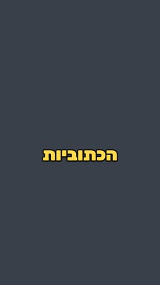</a>
<a href="#cta">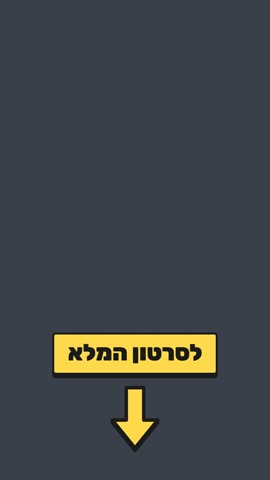</a>
<a href="#bigtext">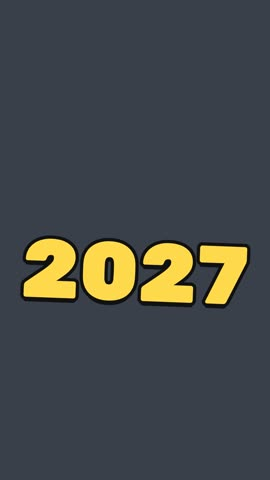</a>
<a href="#sticker"></a>
<a href="#textpop">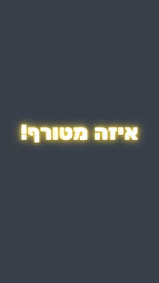</a>
<a href="#alarm">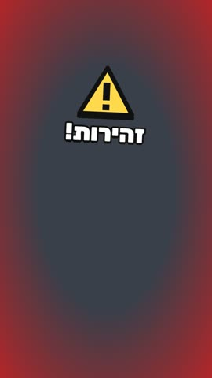</a>
<a href="#morph">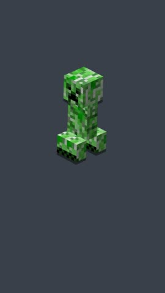</a>
<a href="#frost"></a>
<a href="#lightmeter">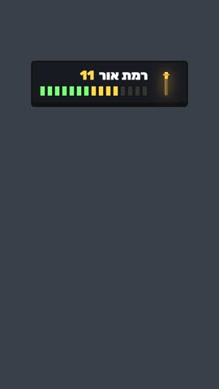</a>
<a href="#lottiefx"></a>
<a href="#youtubecard"></a>
<a href="#youdied">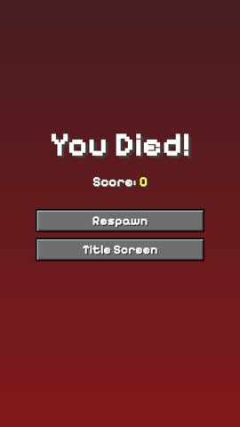</a>
<a href="#advancement">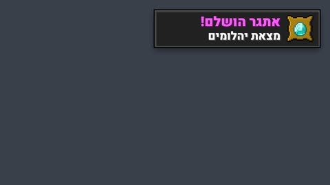</a>
<a href="#advancementv">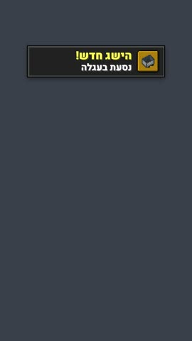</a>
<a href="#itemtooltip">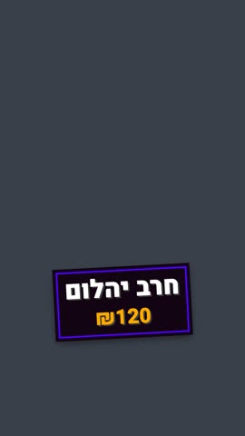</a>
<a href="#speedruntimer">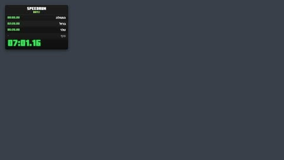</a>
<a href="#routemap">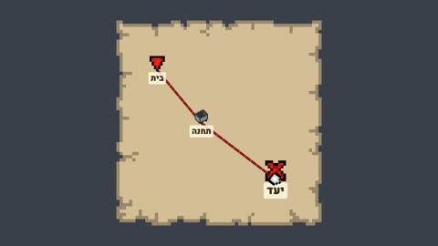</a>
<a href="#flightmap">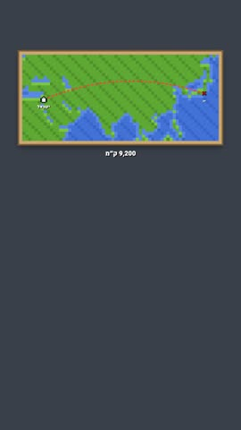</a>
<a href="#wordcards">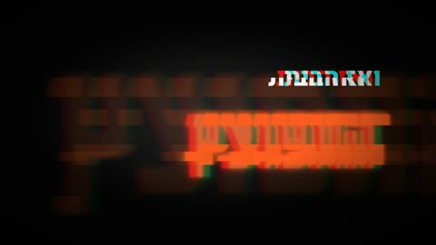</a>
<a href="#wordcardsv">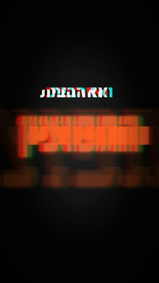</a>
<a href="#chatmessage">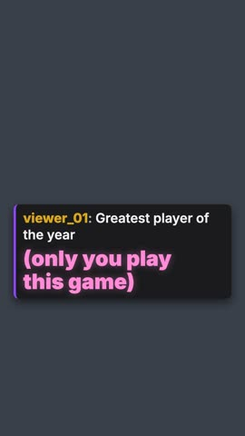</a>

## Captions


Word-group captions: pop in/out, keyword colours, one line, RTL/LTR from the text. Looks: bold, stream, karaoke, mc.  
`1080×1920` · 60 fps · component `Captions`

| prop | type | required | notes |
|---|---|---|---|
| `caps` | { start, end, text, hl, size, words, big, y, top }[] | ✔ | Caption groups with timings (mce.talkshort writes them as caps_props.json) |
| `top` | number |  | Top of the caption line (px). Default 980 |
| `size` | number |  | Font size (px); long groups shrink to stay on one line. Default 118 |
| `seconds` | number |  | Length of the clip in seconds |
| `font` | "rubik" \| "heebo" \| "carlito" \| "minecraft" |  | Default: brand.json captionFont, else rubik |
| `look` | "bold" \| "stream" \| "karaoke" \| "mc" |  | Default: brand.json captionLook, else bold |
| `color` | string |  | Base text colour (highlights come from hl) |

Example:
```bash
npx remotion render Captions out.mov --props='{"caps":[{"start":0,"end":0.6,"text":"ככה נראות"},{"start":0.6,"end":1.3,"text":"הכתוביות","hl":{"הכתוביות":"#FFD84D"}},{"start":1.3,"end":2,"text":"with any language"}],"top":980,"size":118,"seconds":2}' --image-format=png --pixel-format=yuva444p10le --codec=prores --prores-profile=4444
```
<br clear="right">

## CTA


"Watch the full video" pill with a bouncing arrow, for the end of a short.  
`1080×1920` · 60 fps · component `CTA`

| prop | type | required | notes |
|---|---|---|---|
| `label` | string | ✔ | e.g. "לסרטון המלא" |
| `accent` | string |  | Pill and arrow colour. Default: brand accent |

Example:
```bash
npx remotion render CTA out.mov --props='{"label":"לסרטון המלא"}' --image-format=png --pixel-format=yuva444p10le --codec=prores --prores-profile=4444
```
<br clear="right">

## BigText


One huge word that pops in with a tilt (a year, a number, a punch word).  
`1080×1920` · 60 fps · component `BigText`

| prop | type | required | notes |
|---|---|---|---|
| `text` | string | ✔ | One huge word, e.g. "2027" |
| `color` | string |  | Default: brand accent |

Example:
```bash
npx remotion render BigText out.mov --props='{"text":"2027"}' --image-format=png --pixel-format=yuva444p10le --codec=prores --prores-profile=4444
```
<br clear="right">

## Sticker


Tilted label with a hard shadow ("חדש!", a place name).  
`1080×1920` · 60 fps · component `Sticker`

| prop | type | required | notes |
|---|---|---|---|
| `seconds` | number |  | Length of the clip in seconds |
| `text` | string | ✔ |  |
| `bg` | string |  | Default: brand accent2 |
| `color` | string |  | Text colour. Default #111 |
| `top` | number |  | px. Default 360 |
| `size` | number |  | px. Default 120 |
| `tilt` | number |  | Degrees. Default -6 |

Example:
```bash
npx remotion render Sticker out.mov --props='{"text":"חדש!","seconds":1.2}' --image-format=png --pixel-format=yuva444p10le --codec=prores --prores-profile=4444
```
<br clear="right">

## TextPop


A line whose letters pop in one by one with a springy overshoot, a glow and a light sweep.  
`1080×1920` · 60 fps · component `TextPop`

| prop | type | required | notes |
|---|---|---|---|
| `seconds` | number |  | Length of the clip in seconds |
| `text` | string | ✔ | One line; long text shrinks to fit |
| `color` | string |  | Text colour. Default #fff |
| `glow` | string |  | Glow colour. Default: brand accent |
| `size` | number |  | px. Default 150 |
| `top` | number |  | px. Default 820 |
| `by` | "char" \| "word" |  | Pop letter by letter or word by word. Default char |
| `stagger` | number |  | Frames between letters/words. Default 2 |
| `bounces` | number |  | Overshoot bounces. Default 2 |
| `sweep` | boolean |  | Light sweep after it lands. Default true |

Example:
```bash
npx remotion render TextPop out.mov --props='{"text":"איזה מטורף!","seconds":2}' --image-format=png --pixel-format=yuva444p10le --codec=prores --prores-profile=4444
```
<br clear="right">

## Alarm


Pulsing red edges + a warning sign that slams in.  
`1080×1920` · 60 fps · component `Alarm`

| prop | type | required | notes |
|---|---|---|---|
| `seconds` | number |  | Length of the clip in seconds |
| `text` | string |  |  |
| `lang` | "he" \| "en" |  | Language of the built-in labels (default he) |

Example:
```bash
npx remotion render Alarm out.mov --props='{"text":"זהירות!","seconds":1.2}' --image-format=png --pixel-format=yuva444p10le --codec=prores --prores-profile=4444
```
<br clear="right">

## Morph


A turns into B behind a flash and a poof of square particles.  
`1080×1920` · 60 fps · component `Morph`

| prop | type | required | notes |
|---|---|---|---|
| `from` | string | ✔ | Image under public/, e.g. mc/Creeper.webp |
| `to` | string | ✔ | Image it turns into |
| `swapAt` | number | ✔ | Frame of the swap (hidden by a flash + particles) |

Example:
```bash
npx remotion render Morph out.mov --props='{"from":"mc/Creeper.webp","to":"mc/Axolotl.webp","swapAt":23}' --image-format=png --pixel-format=yuva444p10le --codec=prores --prores-profile=4444
```
<br clear="right">

## Frost


The screen freezes over from the edges.  
`1080×1920` · 60 fps · component `Frost`

| prop | type | required | notes |
|---|---|---|---|
| `seconds` | number |  | Length of the clip in seconds |
| `grow` | number |  | Seconds to full frost. Default 1.2 |
| `tint` | number |  | Cold tint strength. Default 0.22 |

Example:
```bash
npx remotion render Frost out.mov --props='{"grow":1.2,"tint":0.22,"seconds":2}' --image-format=png --pixel-format=yuva444p10le --codec=prores --prores-profile=4444
```
<br clear="right">

## LightMeter


Minecraft-style light-level meter that fills up and goes red.  
`1080×1920` · 60 fps · component `LightMeter`

| prop | type | required | notes |
|---|---|---|---|
| `seconds` | number |  | Length of the clip in seconds |
| `label` | string |  |  |
| `warn` | string |  |  |
| `fill` | number |  | How full the meter gets. Default 0.9 |
| `lang` | "he" \| "en" |  | Language of the built-in labels (default he) |

Example:
```bash
npx remotion render LightMeter out.mov --props='{"label":"רמת אור","warn":"חזק מדי!","fill":0.9,"seconds":1.6}' --image-format=png --pixel-format=yuva444p10le --codec=prores --prores-profile=4444
```
<br clear="right">

## LottieFx


A Lottie animation or an animated emoji placed on the frame.  
`1080×1920` · 60 fps · component `LottieFx`

| prop | type | required | notes |
|---|---|---|---|
| `seconds` | number |  | Length of the clip in seconds |
| `src` | string |  | Lottie JSON: URL or file under public/ (mce.lottie downloads to lottie/) |
| `emoji` | string |  | Animated Noto emoji instead of src, e.g. "😂" |
| `size` | number |  | px. Default 360 |
| `x` | number |  |  |
| `y` | number |  | Centre (px). Default: frame centre |
| `loop` | boolean |  |  |
| `speed` | number |  |  |
| `pop` | boolean |  |  |
| `rotate` | number |  | Degrees |

Example:
```bash
npx remotion render LottieFx out.mov --props='{"emoji":"😂","size":420,"seconds":2}' --image-format=png --pixel-format=yuva444p10le --codec=prores --prores-profile=4444
```
<br clear="right">

## YouTubeCard


"The full video is up": the thumbnail on a YouTube watch page, tapped by a finger.  
`1080×1920` · 60 fps · component `YouTubeCard`

| prop | type | required | notes |
|---|---|---|---|
| `seconds` | number |  | Length of the clip in seconds |
| `thumb` | string | ✔ | Thumbnail under public/ |
| `title` | string | ✔ |  |
| `channel` | string |  | Default: brand channel |
| `meta` | string | ✔ | e.g. "הועלה עכשיו" |
| `tapAt` | number | ✔ | Second at which the finger taps the video |
| `lang` | "he" \| "en" |  | Language of the built-in labels (default he) |

Example:
```bash
npx remotion render YouTubeCard out.mov --props='{"seconds":4.58,"thumb":"core/thumb.png","title":"הסרטון המלא כבר בערוץ!","meta":"הועלה עכשיו","tapAt":2.43}' --image-format=png --pixel-format=yuva444p10le --codec=prores --prores-profile=4444
```
<br clear="right">

## YouDied


Minecraft death screen after a hit flash.  
`1080×1920` · 60 fps · component `YouDied`

| prop | type | required | notes |
|---|---|---|---|
| `seconds` | number |  | Length of the clip in seconds |

Example:
```bash
npx remotion render YouDied out.mov --props='{"seconds":1.6}' --image-format=png --pixel-format=yuva444p10le --codec=prores --prores-profile=4444
```
<br clear="right">

## Advancement


Minecraft "Advancement Made!" toast (landscape).  
`1920×1080` · 60 fps · component `Advancement`

| prop | type | required | notes |
|---|---|---|---|
| `seconds` | number |  | Length of the clip in seconds |
| `title` | string |  | Default by frame: הישג חדש / מטרה הושגה / אתגר הושלם |
| `text` | string | ✔ |  |
| `icon` | string | ✔ | File in public/mc/, e.g. Diamond.png |
| `frame` | "task" \| "goal" \| "challenge" |  | challenge = purple, the rare one |
| `scale` | number |  |  |
| `top` | number |  |  |
| `side` | "right" \| "left" \| "center" |  |  |
| `lang` | "he" \| "en" |  | Language of the built-in labels (default he) |

Example:
```bash
npx remotion render Advancement out.mov --props='{"seconds":3,"text":"מצאת יהלומים","icon":"Diamond.png","frame":"challenge","scale":1}' --image-format=png --pixel-format=yuva444p10le --codec=prores --prores-profile=4444
```
<br clear="right">

## AdvancementV


Same toast, placed for vertical video.  
`1080×1920` · 60 fps · component `Advancement`

| prop | type | required | notes |
|---|---|---|---|
| `seconds` | number |  | Length of the clip in seconds |
| `title` | string |  | Default by frame: הישג חדש / מטרה הושגה / אתגר הושלם |
| `text` | string | ✔ |  |
| `icon` | string | ✔ | File in public/mc/, e.g. Diamond.png |
| `frame` | "task" \| "goal" \| "challenge" |  | challenge = purple, the rare one |
| `scale` | number |  |  |
| `top` | number |  |  |
| `side` | "right" \| "left" \| "center" |  |  |
| `lang` | "he" \| "en" |  | Language of the built-in labels (default he) |

Example:
```bash
npx remotion render AdvancementV out.mov --props='{"seconds":3,"text":"נסעת בעגלה","icon":"Minecart.png","frame":"task","scale":0.8,"top":260,"side":"center"}' --image-format=png --pixel-format=yuva444p10le --codec=prores --prores-profile=4444
```
<br clear="right">

## ItemTooltip


Minecraft item tooltip used as a price tag; numbers roll up.  
`1080×1920` · 60 fps · component `ItemTooltip`

| prop | type | required | notes |
|---|---|---|---|
| `seconds` | number |  | Length of the clip in seconds |
| `lines` | { text, color, count, prefix, suffix, at }[] | ✔ |  |
| `top` | number |  |  |
| `scale` | number |  |  |
| `tilt` | number |  |  |

Example:
```bash
npx remotion render ItemTooltip out.mov --props='{"seconds":3,"lines":[{"text":"חרב יהלום"},{"text":"","count":120,"prefix":"₪","color":"#FFAA00","at":0.3}]}' --image-format=png --pixel-format=yuva444p10le --codec=prores --prores-profile=4444
```
<br clear="right">

## SpeedrunTimer


LiveSplit-style speedrun timer with splits.  
`1920×1080` · 60 fps · component `SpeedrunTimer`

| prop | type | required | notes |
|---|---|---|---|
| `seconds` | number |  | Length of the clip in seconds |
| `title` | string |  |  |
| `category` | string |  | e.g. "Any%" |
| `splits` | { label, at }[] | ✔ |  |
| `from` | number | ✔ | Run clock at the start of the clip (s) |
| `to` | number | ✔ | Run clock at the end (s) — a short clip can cover a long run |
| `scale` | number |  |  |
| `corner` | "tl" \| "tr" |  |  |

Example:
```bash
npx remotion render SpeedrunTimer out.mov --props='{"seconds":6,"from":0,"to":600,"scale":0.9,"splits":[{"label":"התחלה","at":0},{"label":"ברזל","at":140},{"label":"נת'ר","at":380},{"label":"סוף","at":600}]}' --image-format=png --pixel-format=yuva444p10le --codec=prores --prores-profile=4444
```
<br clear="right">

## RouteMap


Minecraft filled map that unfolds; a route draws stop to stop.  
`1920×1080` · 60 fps · component `RouteMap`

| prop | type | required | notes |
|---|---|---|---|
| `seconds` | number |  | Length of the clip in seconds |
| `stops` | { x, y, label, icon }[] | ✔ | Positions 0..1 inside the map |
| `upTo` | number |  | Legs to draw (bring the same map back later showing more) |
| `fromLeg` | number |  |  |
| `size` | number |  |  |

Example:
```bash
npx remotion render RouteMap out.mov --props='{"seconds":5,"size":900,"stops":[{"x":0.15,"y":0.2,"label":"בית"},{"x":0.4,"y":0.5,"label":"תחנה","icon":"Minecart.png"},{"x":0.82,"y":0.82,"label":"יעד"}]}' --image-format=png --pixel-format=yuva444p10le --codec=prores --prores-profile=4444
```
<br clear="right">

## FlightMap


Pixel world map with a flight arc and a km counter.  
`1080×1920` · 60 fps · component `FlightMap`

| prop | type | required | notes |
|---|---|---|---|
| `seconds` | number |  | Length of the clip in seconds |
| `size` | number |  |  |
| `top` | number |  |  |
| `from` | { lon, lat, label } |  |  |
| `to` | { lon, lat, label } |  |  |
| `km` | number |  | Distance counter |

Example:
```bash
npx remotion render FlightMap out.mov --props='{"seconds":2.6}' --image-format=png --pixel-format=yuva444p10le --codec=prores --prores-profile=4444
```
<br clear="right">

## WordCards


Documentary kinetic-type opener: base line + huge keyword + handwritten line per card, blur-in, echo, glitch, grain; cards cut on the voice from transcript.json.  
`1920×1080` · 60 fps · component `WordCards`

| prop | type | required | notes |
|---|---|---|---|
| `cards` | { base, keyword, script, theme, keyColor, glow, scriptColor, scriptGlow, echo, glitch, layout, icon, iconSide, iconSize, zoom, start, end, baseAt, keywordAt, scriptAt }[] | ✔ | Cards in order. Each line is found in the transcript after the previous card's words, so repeated words land right |
| `transcript` | string |  | transcript.json from mce analyze, copied under public/ (e.g. projects/x/transcript.json) |
| `offset` | number |  | Transcript second that is 0 of this clip. Default 0 |
| `audio` | string |  | Voiceover under public/ to play under the cards (starts at offset) |
| `grain` | boolean |  | Film grain over everything. Default true |
| `seconds` | number |  | Length of the clip in seconds |
| `resolved` | { start, end, at }[] |  | Filled in by calculateMetadata; leave empty |

Example:
```bash
npx remotion render WordCards out.mov --props='{"cards":[{"base":"כמה","script":"חברים","baseAt":0.1,"scriptAt":0.35,"scriptGlow":true,"end":1.1},{"base":"עולם","keyword":"מיינקראפט","script":"אחד","icon":"mc/Diamond.png","iconSide":"right","baseAt":1.15,"keywordAt":1.5,"scriptAt":1.9,"end":2.6},{"base":"ואז הבית","keyword":"התפוצץ","keyColor":"#FF5A1F","glitch":true,"baseAt":2.7,"keywordAt":3,"end":4},{"base":"זה התחיל כמו","keyword":"סרבייבל","script":"רגיל","theme":"cream","baseAt":4.1,"keywordAt":4.4,"scriptAt":4.8,"end":5.6}]}' --image-format=png --pixel-format=yuva444p10le --codec=prores --prores-profile=4444
```
<br clear="right">

## WordCardsV


Same cards, laid out for vertical video.  
`1080×1920` · 60 fps · component `WordCards`

| prop | type | required | notes |
|---|---|---|---|
| `cards` | { base, keyword, script, theme, keyColor, glow, scriptColor, scriptGlow, echo, glitch, layout, icon, iconSide, iconSize, zoom, start, end, baseAt, keywordAt, scriptAt }[] | ✔ | Cards in order. Each line is found in the transcript after the previous card's words, so repeated words land right |
| `transcript` | string |  | transcript.json from mce analyze, copied under public/ (e.g. projects/x/transcript.json) |
| `offset` | number |  | Transcript second that is 0 of this clip. Default 0 |
| `audio` | string |  | Voiceover under public/ to play under the cards (starts at offset) |
| `grain` | boolean |  | Film grain over everything. Default true |
| `seconds` | number |  | Length of the clip in seconds |
| `resolved` | { start, end, at }[] |  | Filled in by calculateMetadata; leave empty |

Example:
```bash
npx remotion render WordCardsV out.mov --props='{"cards":[{"base":"כמה","script":"חברים","baseAt":0.1,"scriptAt":0.35,"scriptGlow":true,"end":1.1},{"base":"עולם","keyword":"מיינקראפט","script":"אחד","icon":"mc/Diamond.png","iconSide":"right","baseAt":1.15,"keywordAt":1.5,"scriptAt":1.9,"end":2.6},{"base":"ואז הבית","keyword":"התפוצץ","keyColor":"#FF5A1F","glitch":true,"baseAt":2.7,"keywordAt":3,"end":4},{"base":"זה התחיל כמו","keyword":"סרבייבל","script":"רגיל","theme":"cream","baseAt":4.1,"keywordAt":4.4,"scriptAt":4.8,"end":5.6}]}' --image-format=png --pixel-format=yuva444p10le --codec=prores --prores-profile=4444
```
<br clear="right">

## ChatMessage


A live-chat message the streamer reacts to; parts arrive one by one, a big part slams in.  
`1080×1920` · 60 fps · component `ChatMessage`

| prop | type | required | notes |
|---|---|---|---|
| `seconds` | number |  | Length of the clip in seconds |
| `user` | string | ✔ | Chatter's name |
| `userColor` | string |  | Name colour (their real Twitch colour if known). Default #BF94FF |
| `parts` | { text, at, big, color }[] | ✔ | The message, in pieces that can arrive one after another |
| `top` | number |  | px. Default 900 |
| `size` | number |  | px. Default 58 |
| `accent` | string |  | Left bar colour. Default Twitch purple |

Example:
```bash
npx remotion render ChatMessage out.mov --props='{"seconds":3,"user":"viewer_01","userColor":"#DAA520","parts":[{"text":"Greatest player of the year","at":0},{"text":"(only you play this game)","at":1.2,"big":true}]}' --image-format=png --pixel-format=yuva444p10le --codec=prores --prores-profile=4444
```
<br clear="right">
